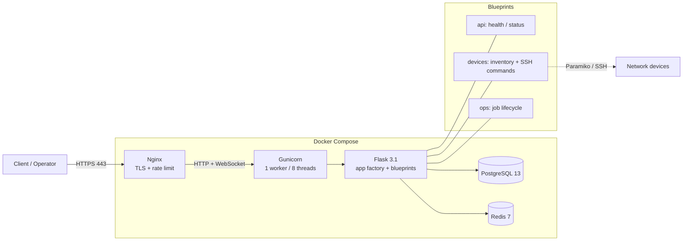

# Flask Microservice Boilerplate

A clean-room reference implementation of the patterns behind a production
NOC / field-services platform: modular Flask blueprints, Gunicorn behind an
Nginx TLS reverse proxy, PostgreSQL and Redis in Docker Compose, structured
JSON logging and read-only operational monitoring.

> **Clean-room notice:** this repository contains no proprietary code, customer
> data, internal hostnames or private IP addresses. It was written from scratch
> to demonstrate the architecture and engineering practices described in the
> [NEXUS case study](https://github.com/R0pr3/nexus-case-study).


## Architecture



## Project layout

```
.
├── app/
│   ├── __init__.py          # application factory
│   ├── config.py            # environment-driven configuration
│   ├── extensions.py        # SQLAlchemy instance
│   ├── models.py            # Device and Job models
│   ├── logging_config.py    # JSON log formatter
│   ├── middleware.py        # request id + access logs
│   ├── realtime.py          # Socket.IO + Redis message queue
│   └── blueprints/
│       ├── api/             # health and status
│       ├── devices/         # device inventory and command execution
│       └── ops/             # job tracking
├── nginx/
│   ├── nginx.conf           # TLS reverse proxy, rate limiting, WebSockets
│   └── certs/README.md      # self-signed certificate instructions
├── scripts/
│   ├── monitor.sh           # read-only operations snapshot
│   └── run-tests.sh
├── tests/
├── docker-compose.yml
├── Dockerfile
└── requirements.txt
```

## Quick start

```bash
cp .env.example .env

# Local TLS certificate (git-ignored)
openssl req -x509 -nodes -newkey rsa:2048 -days 365 \
  -keyout nginx/certs/server.key \
  -out nginx/certs/server.crt \
  -subj "/CN=localhost" \
  -addext "subjectAltName=DNS:localhost,IP:127.0.0.1"

docker compose up -d --build
curl -sk https://localhost/api/v1/health
```

Expected response:

```json
{"status": "ok", "database": "ok"}
```

## API

| Method | Path                           | Description                                             |
|--------|--------------------------------|---------------------------------------------------------|
| GET    | `/api/v1/health`               | Liveness probe (checks the database)                    |
| GET    | `/api/v1/status`               | Version, uptime and dependency checks                   |
| GET    | `/api/v1/devices`              | List devices                                            |
| POST   | `/api/v1/devices`              | Register a device (`name`, `host`, ...)                 |
| GET    | `/api/v1/devices/<id>`         | Device details                                          |
| POST   | `/api/v1/devices/<id>/command` | Run a read-only command (`uptime`, `identity`, `links`) |
| GET    | `/api/v1/jobs`                 | List the 100 most recent jobs                           |
| POST   | `/api/v1/jobs`                 | Create a job (`kind`, optional `device_id`)             |
| GET    | `/api/v1/jobs/<id>`            | Job details                                             |
| PATCH  | `/api/v1/jobs/<id>`            | Update `status` / `output`                              |

Example:

```bash
curl -sk -X POST https://localhost/api/v1/devices \
  -H 'Content-Type: application/json' \
  -d '{"name": "radio-01", "host": "10.0.0.10", "port": 22}'

curl -sk -X POST https://localhost/api/v1/devices/1/command \
  -H 'Content-Type: application/json' \
  -d '{"command": "uptime"}'
```

## Tests

```bash
python -m venv .venv
.venv/Scripts/activate         # Windows
source .venv/bin/activate      # Linux / macOS
pip install Flask "Flask-SQLAlchemy>=3.1" pytest
pytest
```

The suite runs against SQLite in memory and simulates SSH, so it is fast and
deterministic — no database container or network hardware required.

## Design decisions

- **Application factory + blueprints.** Each domain (api, devices, ops) owns its
  routes, keeping modules small and independently testable.
- **JSON errors and request ids.** Every response carries `X-Request-ID`, and the
  access log is a single JSON line ready for Loki / ELK ingestion.
- **Lazy optional dependencies.** Redis and Paramiko are only imported when the
  feature is enabled, so unit tests stay dependency-light.
- **Simulated device access by default.** `SIMULATE_SSH=true` keeps the demo
  runnable without hardware; production uses Paramiko with scoped commands.
- **Nginx at the edge.** TLS 1.2/1.3 only, HSTS and security headers, rate
  limiting on `/api/`, WebSocket upgrade for Socket.IO.

## Security notes

- The container runs as an unprivileged `app` user.
- Secrets come from environment variables (`.env` is git-ignored).
- Only an allow-list of read-only device commands is accepted.
- `scripts/monitor.sh` is strictly read-only: UFW, Fail2Ban, container health
  and log scanning without changing any state.

## Extending

1. Create `app/blueprints/<domain>/routes.py` with a `Blueprint`.
2. Register it in `create_app()`.
3. Add tests under `tests/test_<domain>.py`.

## License

MIT — see [LICENSE](LICENSE).
